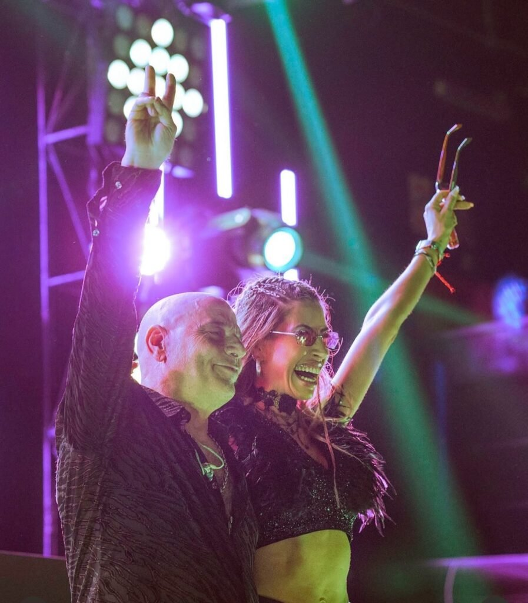
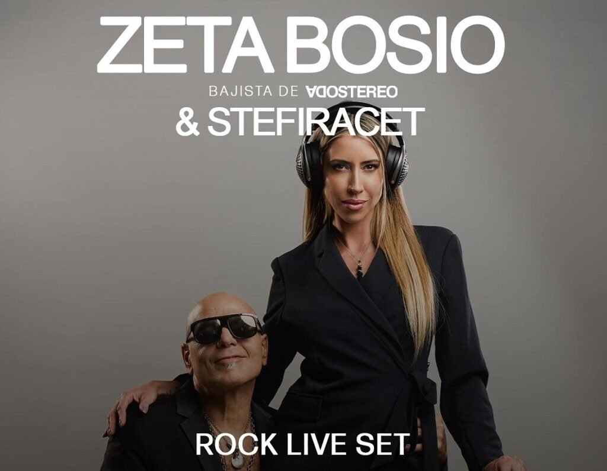

In the music world, there are names that shine brightly, but few combine artistic talent, business vision, and the ability to manage a career like Estefanía Iracet. Not only is she the manager of one of the most iconic artists in Latin American music, Zeta Bosio, but she's also a DJ and music producer, a multifaceted woman who has made her mark on the industry since 2010. With a presence in Miami that doesn't go unnoticed, Stefi has managed to win over not only her audience but also those who follow her innovative vision.

<!-- SINGLE IMAGE -->

Beyond her impressive ability to manage Zeta Bosio's career, Estefanía has managed to balance her professional life with her role as a mother, enjoying every moment with her daughter Anastasia, her main source of inspiration and motivation. Known for her sensual and fashionable style, Stefi has proven that it's possible to be a successful businesswoman, a talented artist, and an exemplary mother all at the same time. In her daily life, she carries herself with naturalness and charisma, a unique blend of elegance and energy that makes her a benchmark not only in music but also in lifestyle.

<!-- SINGLE IMAGE -->

Stefi isn't just a talent manager; she's also an artist in her own right. Her work as a DJ and music producer is an extension of her creativity, where she fuses the rhythms of electronic music with the classics of Soda Stereo, the band that shaped her life and that of her husband, Zeta Bosio.

Together, as part of a tour spanning Latin America and Miami, they manage to offer a unique experience where the nostalgia of rock meets the modernity of tech house, creating a sound that runs through the veins of those who listen.

Estefanía's magic lies in her ability to make everything fit together perfectly. As Zeta Bosio's manager, she is in charge of managing contracts, coordinating press, managing social media, and, of course, being primarily responsible for event and tour production. The way she manages Zeta's career is a true masterpiece of organization and business vision, where every detail is meticulously curated to ensure Soda Stereo's music remains relevant in the hearts of fans, while reaching new audiences with a renewed sound.

<!-- SINGLE IMAGE -->

However, beyond her role as a businesswoman and producer, Estefanía has demonstrated a remarkable ability to connect with people. Her charisma, empathy, and unique style have earned her the respect of colleagues and artists, making her a key figure in the music industry. Her life isn't just about work; it's a blend of passion for music, love for her family, and unwavering dedication to her projects.

<!-- GALLERY: images are separated by | and cols can be 2, 3 or 4 -->


[@stefiracet](https://www.instagram.com/stefiracet/?hl=en)
