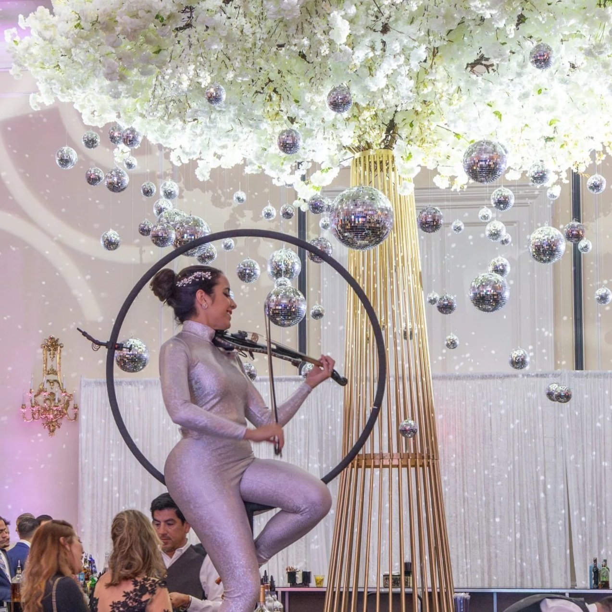

Miami dressed up to welcome a host of notables who came together to support an extraordinary cause: the Supreme Twins Foundation.

This event focused on the foundation's main objective: to provide comprehensive support to children and adolescents with special needs and their families, helping to create a more inclusive future full of opportunities for the most vulnerable.

<!-- SINGLE IMAGE -->

The Supreme Twins Foundation works tirelessly to provide these families with essential resources in three key areas. First, they offer access to essential therapeutic services, improving the quality of life for these children and adolescents. Second, they focus on ensuring these young people have access to education and career opportunities that will allow them to fully integrate into society. Finally, they provide emotional support and resources to parents, helping them guide their children through this important process of growth and development.

<!-- SINGLE IMAGE -->

The event, held in an elegant and supportive atmosphere, was attended by prominent figures from the worlds of entertainment and television, who showed their unwavering support for this worthy cause.

Among the celebrities in attendance were Adamari López, Lena Burke, Aly Sánchez, 【entity-Gloria Ordaz¦canonical_name=Gloria Ordaz】, Alberto Sardina, Elizabeth López, Pedro Camacho, Yaima Ortiz, Alexander Delgado, and Randy Malcom Martínez, members of the famous duo Gente de Zona, among others.

The event was hosted by the charismatic masters of ceremonies, Eileen Cardet and Jorge Hernández, who guided the evening with enthusiasm and professionalism, making it a memorable evening.

Throughout the evening, attendees enjoyed a series of moving presentations and speeches, as well as a charity auction, all aimed at raising funds to continue the foundation's work.

<!-- GALLERY: images are separated by | and cols can be 2, 3 or 4 -->


The gala was not only a success in terms of fundraising, but also reaffirmed the Miami community's commitment to the inclusion, education, and well-being of children and adolescents with disabilities, providing them with the necessary tools to ensure their futures are bright and full of possibilities.

<!-- GALLERY: images are separated by | and cols can be 2, 3 or 4 -->
{% include gallery.html folder="/images/culture" images="IMG_7099.jpg|Brenda Navarrete.jpg|IMG_7100.jpg|Pedrito Camacho y Elizabeth López.jpg|3. 【entity-Gloria Ordaz¦canonical_name=Gloria Ordaz】.jpg|19 Alberto Sardiñas.jpg|14. Luciana Tabeni e Ignacio Huergo.jpg|15 Florencia Tabeni y Gabriel Carballada .jpg|18 Julia Alzate.jpg|9. Alegna Cambra.jpg|11.  Nicholas López Morillo y Lucy Morillo.jpeg|13. Celina y Filiberto Ganas con Canas.jpeg|16. Carlos Mejia.jpg|7 Yaima Ortiz.jpeg|1. PRINCIPAL Ilieva y Miguel Valdes con Adamari López.jpg|8. Luis Hoyos, Lena Burke y Juan Chipoco.jpeg|12 - Carlos Anaya.jpg|10.  Lisbet Fernández Viña y Joseph Rodríguez.jpg" cols=3 %}

<!-- SINGLE IMAGE -->

