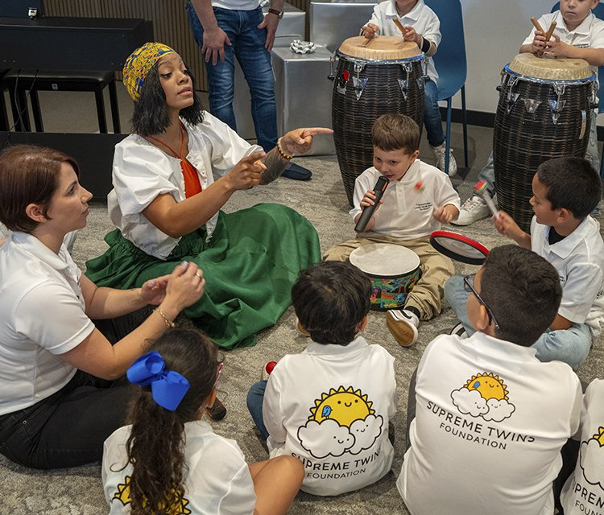

Music and inclusion came together for a deeply emotional day with talented percussionist Brenda Navarrete and the children of the Supreme Twins Foundation. With Latin rhythms and live percussion, the gathering became a unique experience filled with smiles, hugs, and a moving rendition of "Happy Birthday" that left a lasting impression on everyone present.

<!-- VIDEO: YouTube or Vimeo link, or file="/assets/video/clip.mp4" -->


From the very beginning, Brenda connected with the children with a natural warmth. Her contagious energy and the power of her drums sparked excitement and participation. Music became a common language that broke down barriers and allowed each child to express themselves freely and joyfully.

One of the most memorable moments was when everyone joined together to sing and play to the rhythm of a special celebration. It was more than a song: it was a manifestation of love and community. In those minutes, the true value of this experience was epitomized, where everyone could feel seen and valued.

<!-- SINGLE IMAGE -->

The day was also a powerful example of the impact of music therapy. Through rhythm and sound, many children were able to open up, communicate emotions, and share their inner world. Music, more than entertainment, was a channel of healing, connection, and empowerment.

This event was made possible thanks to the unconditional support of Bertha M. Moreno, who has been a fundamental ally in making initiatives like this a reality. Her commitment to community inclusion and well-being inspires and enables art to reach those most in need.

To learn more about this valuable work, you can visit [www.supremetwins.org](http://www.supremetwins.org/) or follow the foundation on Instagram at [@supreme_twins_foundation](https://www.instagram.com/supreme_twins_foundation). Because when music becomes a bridge, what emerges is pure transformation.

<!-- GALLERY: images are separated by | and cols can be 2, 3 or 4 -->


<!-- SINGLE IMAGE -->

