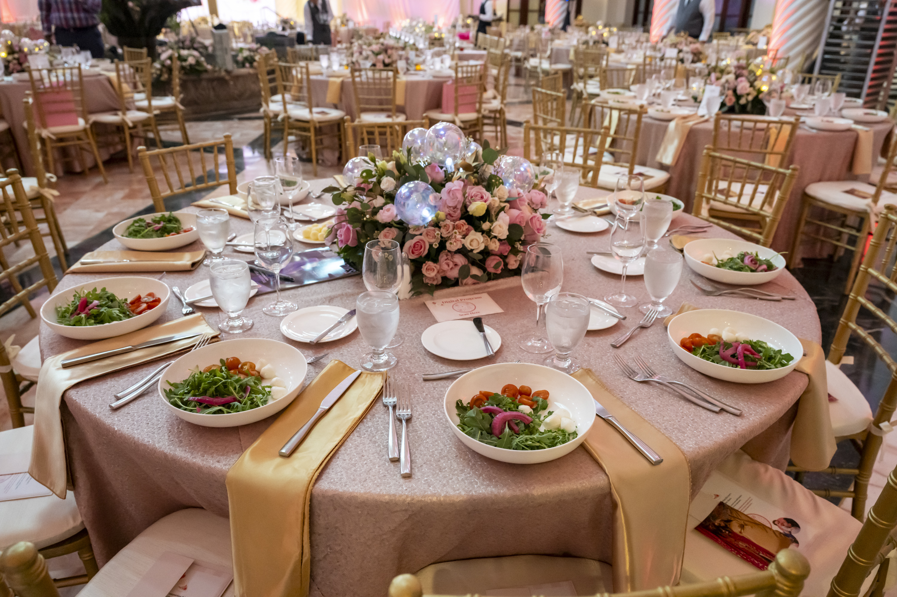
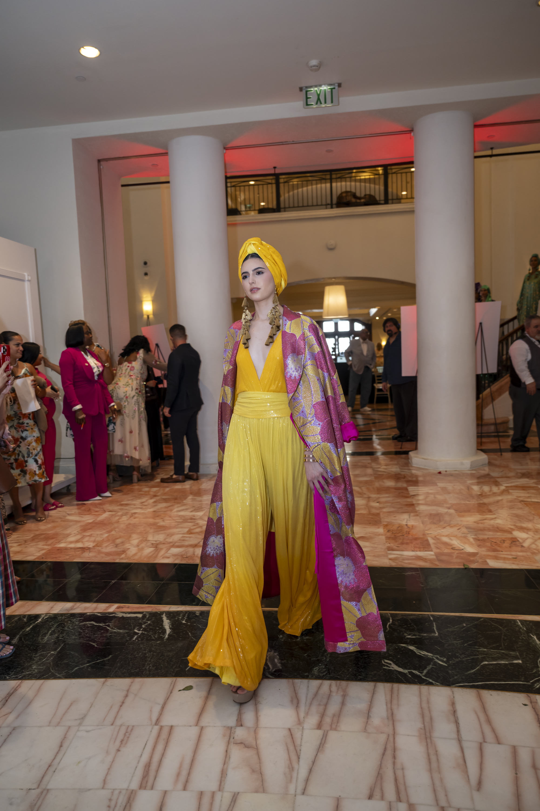
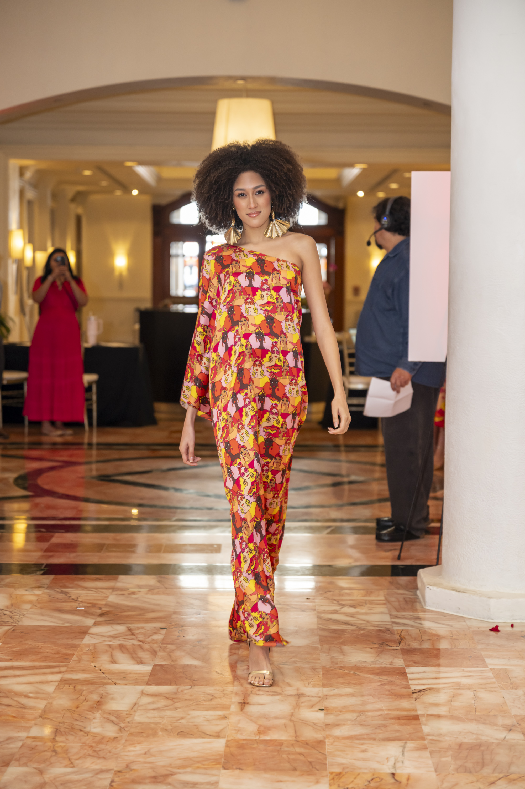
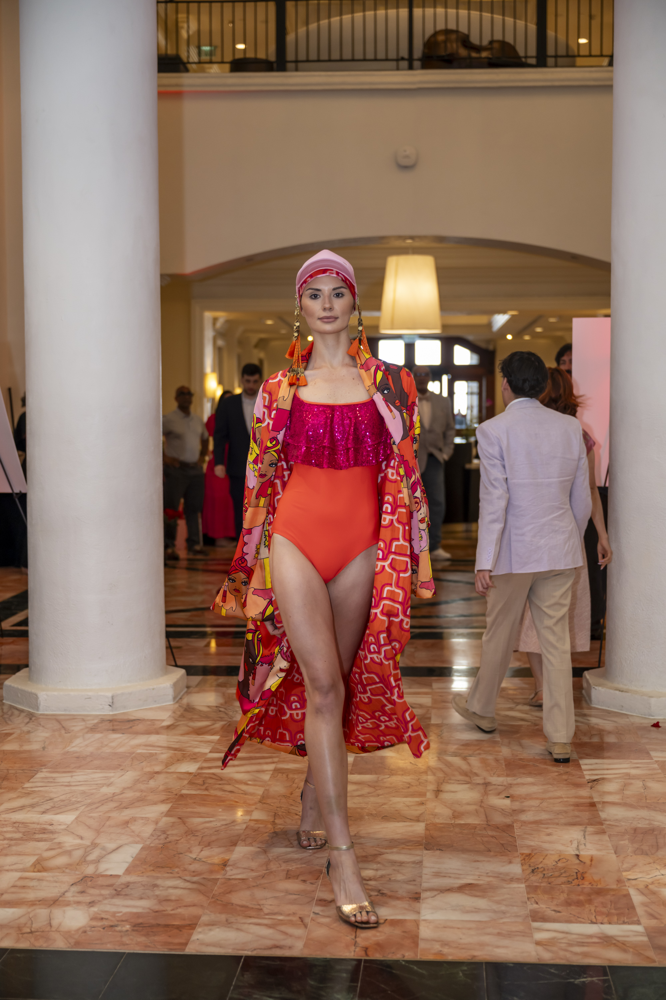
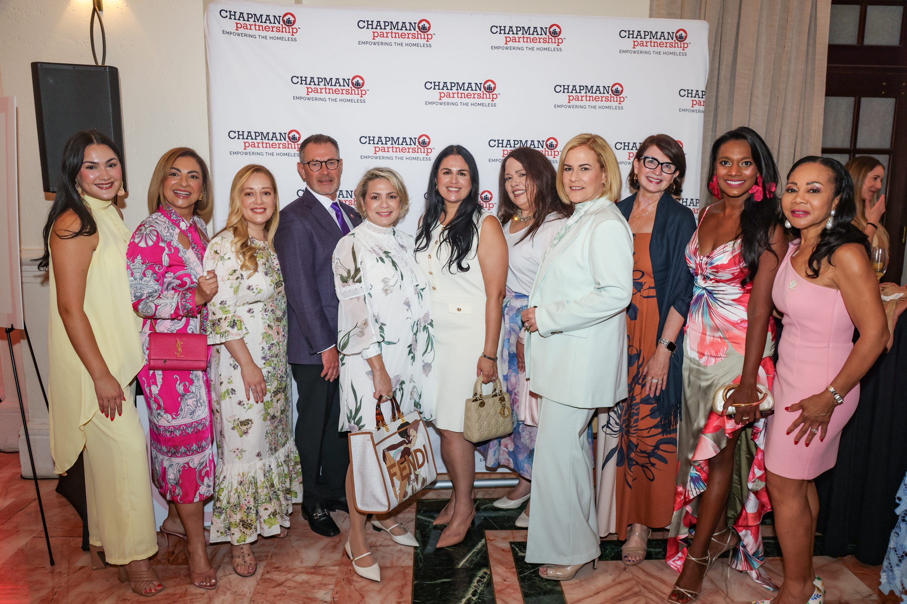
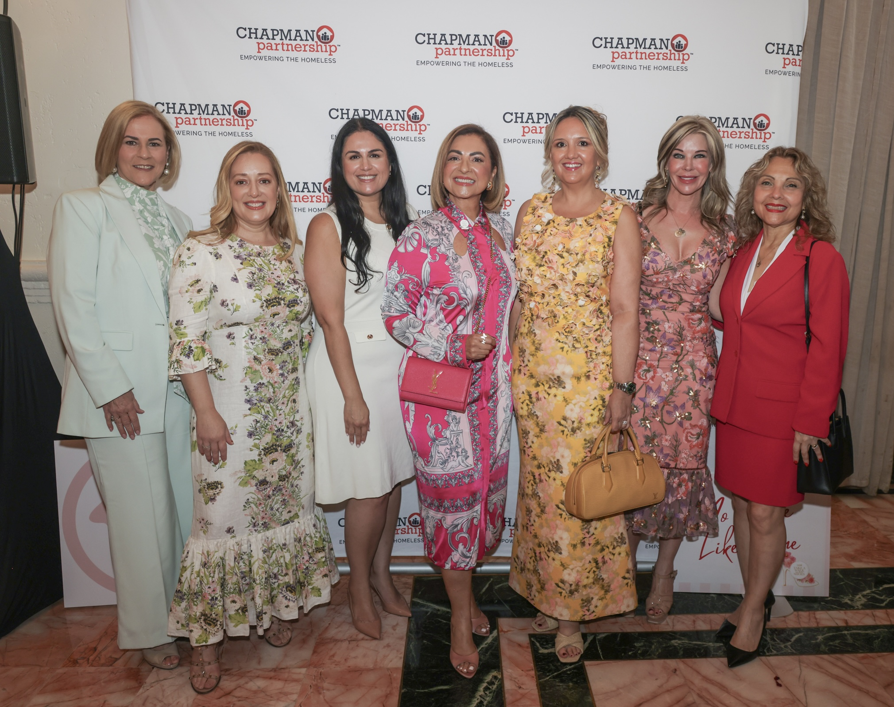
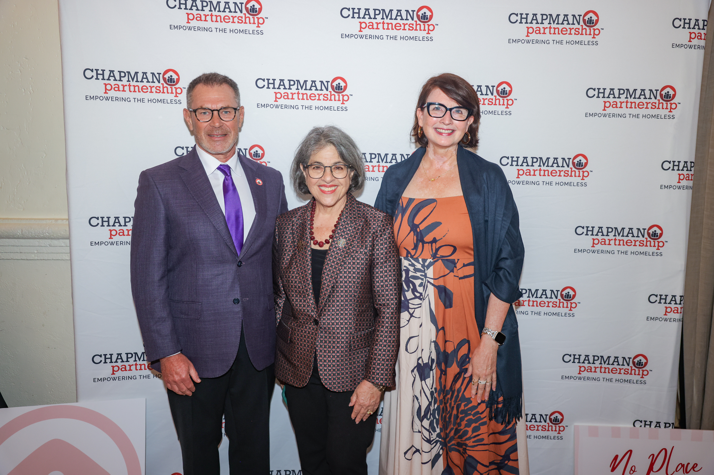
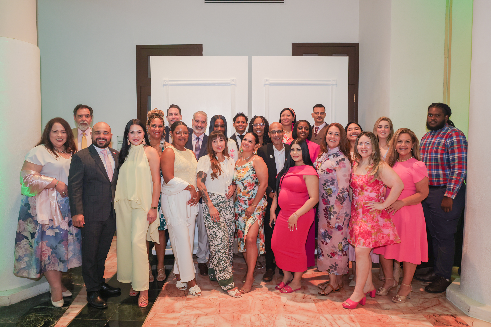

Chapman Partnership Hosts Take a Walk in Her Shoes 2026 at Hotel Colonnade Coral Gables

An afternoon rooted in purpose, elegance, and community impact unfolded at the iconic Hotel Colonnade Coral Gables, Autograph Collection as Chapman Partnership welcomed guests to its annual Take a Walk in Her Shoes luncheon and fashion experience.

Bringing together more than 400 philanthropists, civic leaders, corporate partners, and advocates from across South Florida, the highly anticipated event shined a light on the realities faced by women and children experiencing homelessness in Miami-Dade County, while celebrating the transformative power of compassion, opportunity, and collective support.

This year’s luncheon honored an inspiring group of women whose leadership and dedication continue to create meaningful impact throughout the community. Guests gathered for an afternoon that seamlessly blended philanthropy, fashion, and storytelling, all while supporting Chapman Partnership’s ongoing mission of providing comprehensive programs and long-term solutions for families experiencing homelessness.

Throughout the event, attendees were reminded that homelessness is not defined by circumstance alone, but by the urgent need for resources, stability, guidance, and human connection. Through its work, Chapman Partnership continues to provide education, healthcare support, job placement assistance, mental health services, and housing-focused programs designed to help individuals and families rebuild their lives with dignity and hope.

Set against the timeless backdrop of Coral Gables, the luncheon reflected both sophistication and substance, creating a meaningful atmosphere where advocacy and community engagement took center stage. From heartfelt moments shared on stage to conversations taking place throughout the ballroom, Take a Walk in Her Shoes 2026 served as a powerful reminder of what can be accomplished when a community comes together with purpose, compassion, and a commitment to lasting change.

