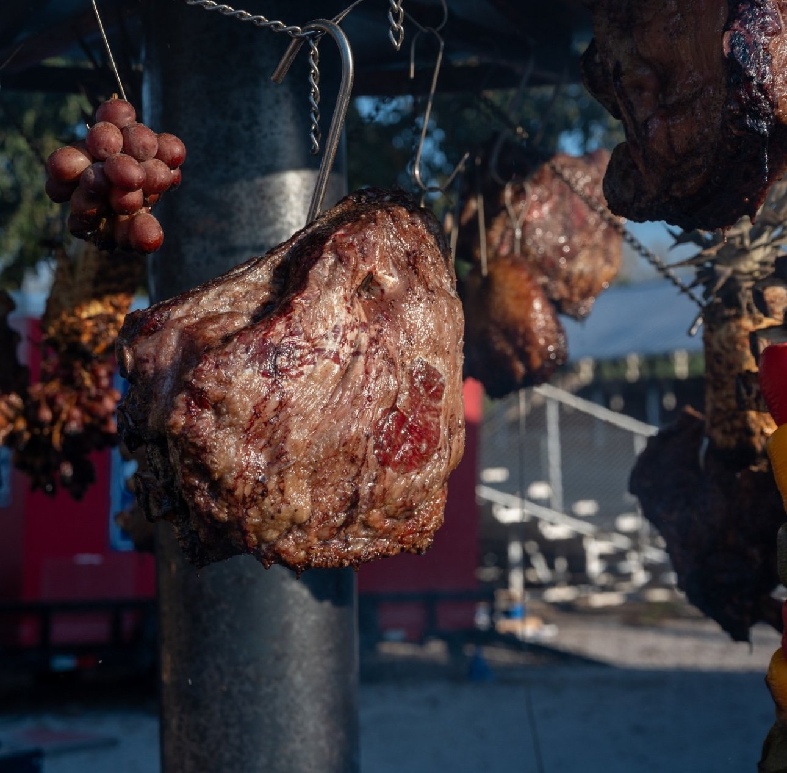
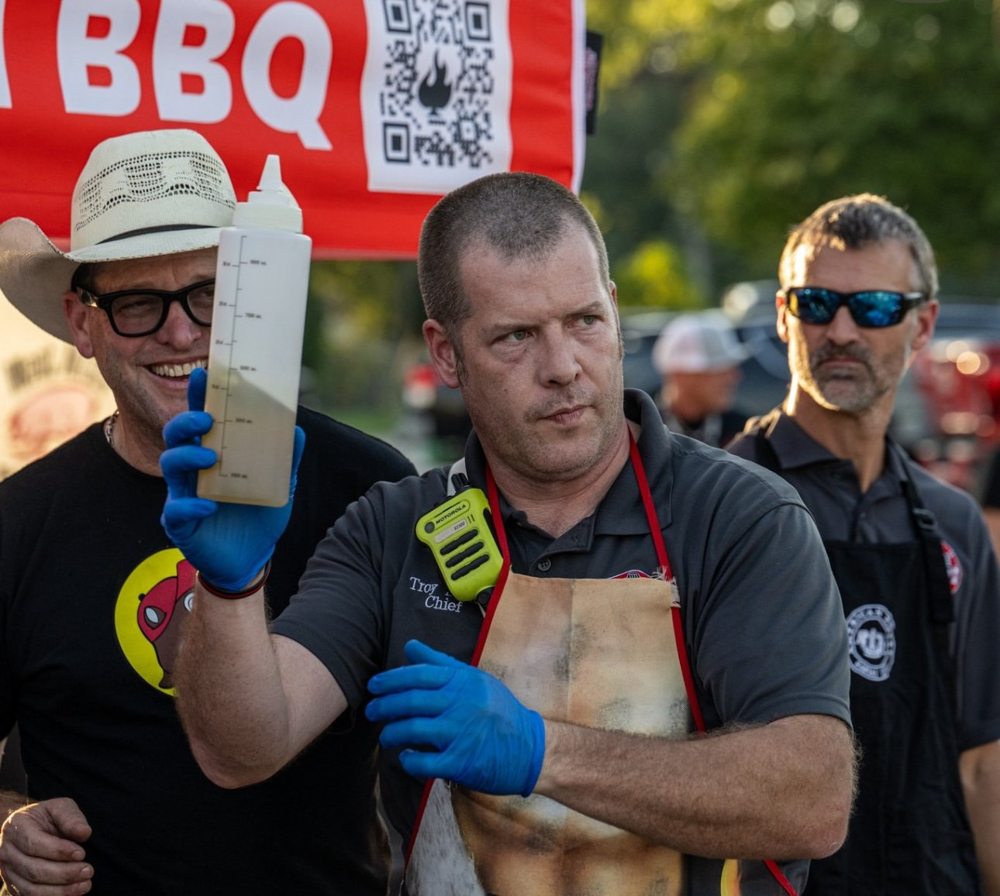
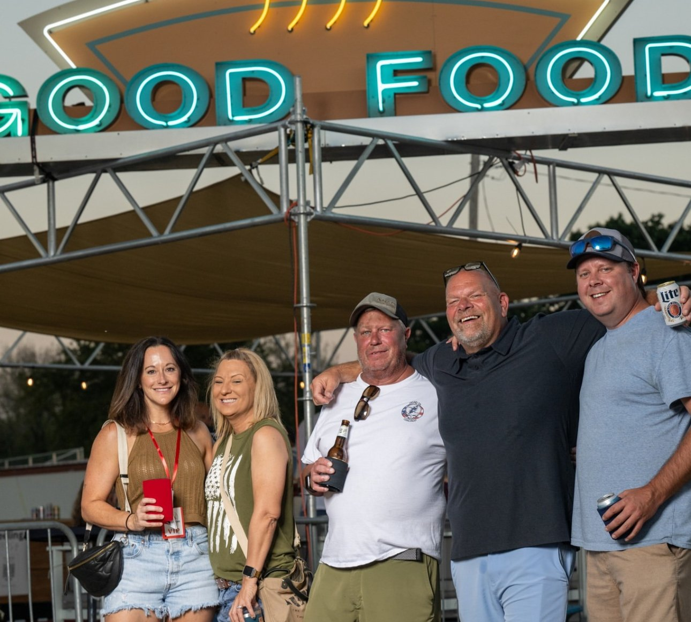

Espíritu Parrillero [@espiritu.parrillero](https://www.instagram.com/espiritu.parrillero), [@espirituparrillero.world](https://www.instagram.com/espirituparrillero.world) took center stage at the Carnivore Carnival [@carnivore_carnival_usa](https://www.instagram.com/carnivore_carnival_usa) in Kansas City, a festival dedicated entirely to the culture of live-fire cooking and barbecue. The event, curated by Creg Carter [@aceswildbbqandlivefire](https://www.instagram.com/aceswildbbqandlivefire), brought together top pitmasters, grillers, and culinary brands from across the U.S. and Latin America. With music, smoke, and cocktails by Jack Daniel’s (#JackDaniels), the atmosphere was a true celebration of community through fire.

<!-- SINGLE IMAGE -->

Espíritu Parrillero wasn’t just another participant — they were a powerful presence. Representing the soul of Argentine grilling, they offered more than products or techniques. They brought a philosophy: that fire is about connection. Their presence was felt through activations, collaborations, and their passionate support for fellow chefs and brands, showing the depth of their commitment to uniting the global BBQ community.

More than a brand, Espíritu Parrillero is a movement that brings together companies, chefs, and suppliers devoted to the art of the Argentine open-fire asado. Their offerings go beyond equipment, they create experiences. These include professional consulting, corporate masterclasses, catering, restaurant activations, and curated products for restaurants, wine shops, and BBQ stores. As they say: “The Espíritu Parrillero is not only seen — it is felt.”

<!-- SINGLE IMAGE -->

Among the standout figures at the festival was Randy Pauly [Instagram @randypaulyofficial](https://www.instagram.com/randypaulyofficial), Director and Pitmaster of Holy Cow Cookers BBQ [Instagram @holycowcookers](https://www.instagram.com/holycowcookers).

As host and entertainer, he brought humor, energy, and charisma, becoming one of the most engaging voices during the grilling competitions. His long-standing presence in the Texas BBQ scene brought authenticity and Southern soul to the event.

Another top name was Sunny Moody ([Instagram @sunnylynn_grilledfit](https://www.instagram.com/sunnylynn_grilledfit)), World Champion in Steak and Live Fire BBQ. A Food Network personality, chef, and personal trainer, Sunny has become a powerful voice for women in barbecue. Her combination of culinary skill, nutritional awareness, and stage presence left a strong impression on everyone at the festival.

Alejo Frugoni ([@alfrugoni](https://www.instagram.com/alfrugoni), [@alfrugonishop](https://www.instagram.com/alfrugonishop)), an Argentine chef and live-fire icon, continues to expand his legacy with the upcoming Open Fire Meat Up in Hongos, Texas ([@openfiremeatup](https://www.instagram.com/openfiremeatup)). Known for his authentic style and passion for open-fire cooking, Alejo has become a key figure in the international barbecue community. Invited by Espíritu Parrillero, we’ll be attending this gathering that promises to unite some of the best grill masters and fire enthusiasts in an atmosphere of friendship and flavor.

<!-- SINGLE IMAGE -->

Dustin Green [Instagram @dustingreen](https://www.instagram.com/_dustingreen_), [Website: weber.com](https://www.weber.com/) represented Weber Grills [Instagram @webergrills](https://www.instagram.com/webergrills) as their Head Grill Master. A classically trained chef and educator, he leads the Weber Grill Academy & BBQ Experience, sharing his passion for grill mastery with audiences worldwide. His knowledge and approachable style made him a favorite among both pros and amateurs.

From Central America, Quique Ruiz Matamoros [Instagram @sociedaddelasado](https://www.instagram.com/sociedaddelasado) brought flavor and fire with La Sociedad del Asado, a catering company that elevates grilling into a modern gastronomic experience. Known for his innovative approach to smoked meats and parrilla, Quique announced the upcoming Festival del Asado Guatemala 2026 [Instagram @festivaldelasadogt](https://www.instagram.com/festivaldelasadogt), promising music, food, and camaraderie.

From Kansas City, Los Hornos ([@loshornos.kc](https://www.instagram.com/loshornos.kc)) captivated everyone with its unmistakable Tucumán flavors. Their handmade empanadas and grilled sweetbreads were a huge success, proudly representing Argentina at the festival. The team from Los Hornos combined tradition and technique, bringing a true taste of northern Argentina to the heart of the event.

Benjamin Fuentes [Instagram @kansascityfoodiefinds](https://www.instagram.com/kansascityfoodiefinds), [@benfuentesjr](https://www.instagram.com/benfuentesjr) stood out as a key connector in Kansas City’s food culture. As a content creator and the “Beef Guy” for Booth Creek Wagyu [Instagram @boothcreekwagyu](https://www.instagram.com/boothcreekwagyu), Ben is known for supporting local businesses and spotlighting culinary talent in the region. His passion for community and storytelling resonated with the mission of Espíritu Parrillero.

<!-- GALLERY: images are separated by | and cols can be 2, 3 or 4 -->



