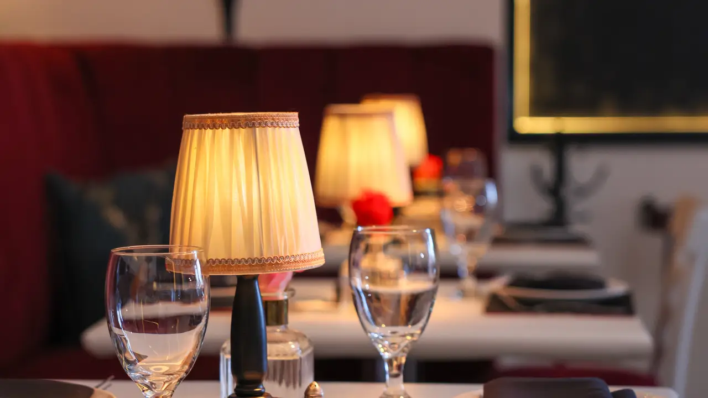

Hidden within the mezzanine of Oceanside Plaza Condominium, Lola Restaurant is one of those Miami secrets that locals whisper about and visitors never forget. The name evokes a free-spirited woman, sophisticated, passionate, and full of life. That same spirit defines Lola: a place where every detail celebrates discovery, connection, and the joy of living well.

Behind Lola’s magic is Gonzalo, whose years of experience in upscale nightlife gave him the vision to create more than a restaurant, a destination. Every element, from the ambient lighting to the textures in the décor, is designed to delight the senses. His understanding of elegance and hospitality has shaped Lola into an atmosphere where every visit feels exclusive yet effortlessly welcoming

<!-- SINGLE IMAGE -->

When Gonzalo met Suzzet, their partnership became the heart of the brand. Together they brought Lola to life and to another level. After marrying and welcoming their daughter, it was Suzzet who encouraged Gonzalo to make Lola a truly unique space, one that merged fine dining with live artistry. Her intuition was right: Lola quickly became a stage for unforgettable nights.

Music is part of Lola’s identity. The restaurant regularly hosts world-class Latin artists like Diana Fuentes, Amaury Gutiérrez, and Francisco Céspedes, turning dinners into immersive experiences. These performances transform the space, laughter, applause, and melodies fill the room, creating memories that linger long after the last song.

<!-- GALLERY: images are separated by | and cols can be 2, 3 or 4 -->


At Lola, every dish is a reflection of its dual soul: Buenos Aires passion meets Miami freshness. The kitchen combines traditional Argentine recipes with modern culinary techniques, resulting in a menu that’s both creative and deeply comforting. Each plate is a small story told through flavor, vibrant, honest, and inspired.

The signature cocktails deserve their own spotlight. Handcrafted with premium spirits and fresh local ingredients, they capture the balance between elegance and playfulness. Think tropical aromas, bold combinations, and that perfect toast that starts an unforgettable night.

<!-- GALLERY: images are separated by | and cols can be 2, 3 or 4 -->


Dining at Lola is not just about food, it’s about connection. It’s where friends gather, couples celebrate, and visitors feel like part of a secret club. Every evening is designed to surprise: the lighting, the music, the energy. It’s intimate, romantic, and alive with Latin rhythm.

Lola Restaurant isn’t just a place to dine, it’s a mood, a memory, a destination. A piece of Buenos Aires reinvented in the heart of Miami Beach, where every night celebrates beauty, art, and the pleasure of good company.

LOLA RESTAURANT – MIAMI BEACH

Address: 5555 Collins Ave, Miami Beach, FL 33140, USA - Phone: (305) 397-8848

Email: [lolarestaurantgrill@gmail.com](mailto:lolarestaurantgrill@gmail.com)  Website: [www.lolarestaurantgrills.com](https://lolarestaurantgrills.com/) Instagram: [@lolarestaurantgrill](https://www.instagram.com/lolarestaurantgrill)

<!-- GALLERY: images are separated by | and cols can be 2, 3 or 4 -->


<!-- GALLERY: images are separated by | and cols can be 2, 3 or 4 -->


<!-- GALLERY: images are separated by | and cols can be 2, 3 or 4 -->


<!-- SINGLE IMAGE -->
.png)
