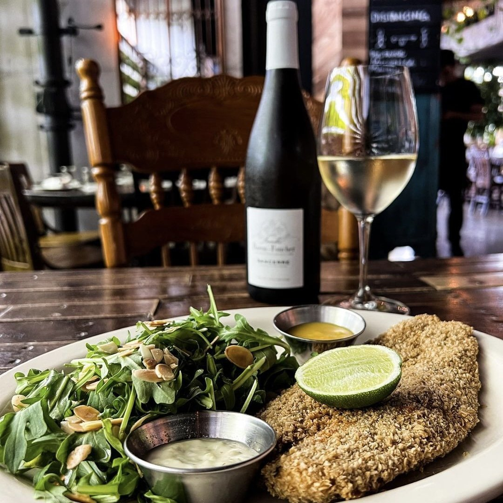
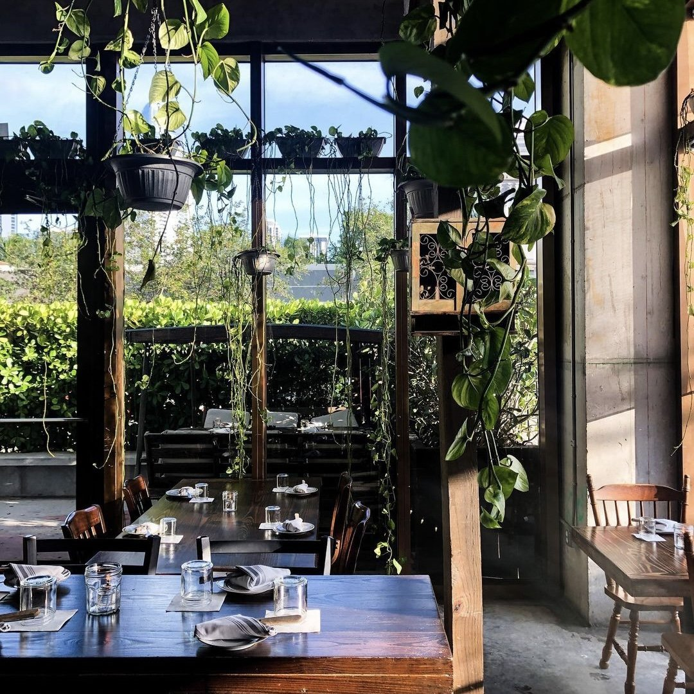

Nestled in the vibrant neighborhood of Miami, Bunbury has quickly established itself as a must-visit destination for food enthusiasts and casual diners alike. This contemporary restaurant offers a unique blend of innovative cuisine, warm hospitality, and an inviting atmosphere that captures the essence of Miami's dynamic culinary scene. From the moment you step through the doors, you are greeted with an ambiance that perfectly balances sophistication and comfort, making it an ideal spot for any occasion.

The menu at Bunbury Miami is a testament to the creativity and skill of its culinary team. Each dish is thoughtfully crafted using locally sourced ingredients and global culinary techniques, resulting in a dining experience that is both familiar and exciting. The restaurant takes pride in offering seasonal selections that highlight the freshest produce and proteins available, ensuring that every visit brings something new to discover. Whether you are a fan of classic comfort food or adventurous flavors, the diverse menu has something to satisfy every palate.

<!-- SINGLE IMAGE -->

One of the standout features of Bunbury is its commitment to creating dishes that are not only delicious but also beautifully presented. The chefs pay meticulous attention to detail, transforming each plate into a work of art that delights the eyes before tantalizing the taste buds. From vibrant salads bursting with color to perfectly seared steaks with rich, complex sauces, every element on the plate is designed to create a harmonious and memorable dining experience.

The beverage program at Bunbury Miami is equally impressive, featuring an extensive selection of wines, craft cocktails, and artisanal beverages. The knowledgeable bartenders and sommeliers are passionate about their craft and are always ready to recommend the perfect pairing for your meal. Whether you prefer a classic cocktail with a modern twist or a rare vintage wine, the drink menu offers an array of options that complement the culinary offerings and enhance the overall dining experience.

<!-- SINGLE IMAGE -->

Beyond the exceptional food and drinks, Bunbury Miami is known for its outstanding service. The staff is attentive, friendly, and genuinely committed to ensuring that every guest feels welcomed and well cared for. They take the time to understand individual preferences and dietary requirements, making personalized recommendations that elevate the dining experience. This dedication to hospitality has earned Bunbury a loyal following and numerous accolades from both critics and diners.

<!-- SINGLE IMAGE -->

The interior design of Bunbury reflects the restaurant's philosophy of blending elegance with approachability. The space features contemporary decor with warm lighting, comfortable seating, and thoughtful touches that create an intimate yet lively atmosphere. Whether you are enjoying a romantic dinner for two, celebrating a special occasion with friends, or hosting a business lunch, the versatile layout and inviting environment make Bunbury the perfect setting.

<!-- SINGLE IMAGE -->

Bunbury Miami also offers private dining options for those looking to host exclusive events or celebrations. The private dining spaces can be customized to suit your specific needs, and the culinary team is happy to work with you to create a bespoke menu that reflects your vision. From corporate gatherings to milestone birthdays and intimate weddings, the restaurant provides a memorable backdrop and exceptional service that will impress your guests.

<!-- SINGLE IMAGE -->

The restaurant's location in Miami makes it easily accessible and a convenient choice for both locals and visitors exploring the city. Surrounded by cultural attractions, shopping destinations, and entertainment venues, Bunbury serves as an ideal starting point or ending note to a day of exploring everything Miami has to offer. Its central position and reputation for excellence make it a popular choice for those seeking a refined dining experience in the heart of the city.

In addition to its regular dining services, Bunbury Miami frequently hosts special events, tasting menus, and seasonal celebrations that showcase the culinary team's creativity and passion. These events provide guests with unique opportunities to experience new flavors, meet the chefs, and engage with the vibrant food community that Bunbury has cultivated. Following their social media channels and website is a great way to stay informed about upcoming events and exclusive offerings.

<!-- SINGLE IMAGE -->

For more information or to make a reservation, you can visit Bunbury Miami at their website or reach out directly through their contact channels. The restaurant is located at 2001 Meridian Avenue, Miami Beach, FL 33139. You can contact them by phone at +1 305 673 6350 or send an email to [info@bunburymiami.com](mailto:info@bunburymiami.com). Follow them on Instagram at @bunburymiami to stay updated on the latest menu items, events, and special promotions. Bunbury Miami is open Monday through Thursday from 5:00 PM to 11:00 PM, Friday and Saturday from 5:00 PM to midnight, and Sunday from 5:00 PM to 10:00 PM. Whether you are planning a special night out or simply looking for exceptional cuisine in a welcoming environment, Bunbury Miami awaits to provide an unforgettable dining experience.


