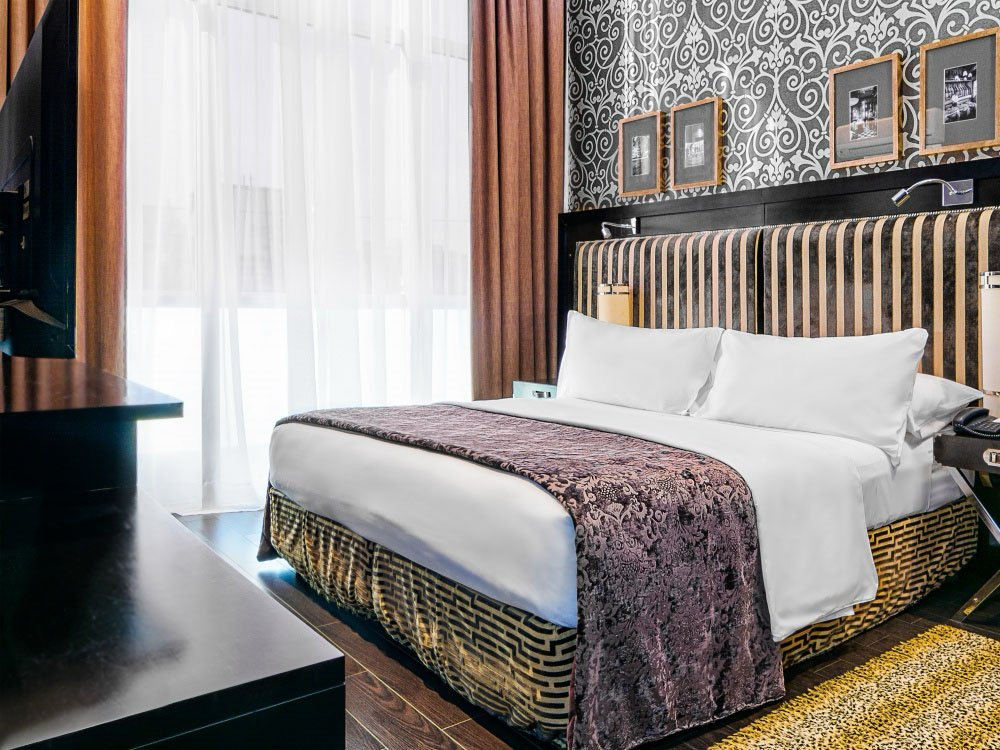

Lennox Hotel Buenos Aires presents itself as an exclusive urban oasis in the heart of Argentina’s vibrant capital city. With its avant-garde style and modern urban design, this hotel redefines the concept of contemporary hospitality, combining state of the art technology with personalized service to ensure an unforgettable experience for every guest.

<!-- SINGLE IMAGE -->

Strategically located in downtown Buenos Aires, the Lennox offers 57 carefully designed accommodation options to meet the needs of the most discerning travelers. Each room has been thoughtfully created with comfort and pleasure in mind, showcasing a cutting-edge Argentine style that blends elegance with functionality. The hotel firmly believes that style and comfort are essential elements of any quality lodging experience.

One of the property’s highlights is its terrace, an ideal space to enjoy Buenos Aires’ pleasant weather, especially in spring. This privileged spot allows guests to relax outdoors while taking in panoramic city views, making it the perfect setting for memorable moments in a sophisticated and welcoming atmosphere.

<!-- SINGLE IMAGE -->

Lennox Hotel Buenos Aires stands out not only for its lodging facilities but also for its capacity to host all kinds of events and meetings. With a wide variety of event spaces, the hotel provides the perfect setting for celebrations, business conferences, or any special occasion. Life is a celebration, and Lennox is committed to creating memorable experiences for every guest.

The hotel’s commitment to excellence extends to every aspect of the guest experience. From arrival to departure, every detail is meticulously planned to exceed expectations. The highly trained staff provides personalized service that distinguishes the Lennox from other establishments, ensuring each stay is truly unique and special.

<!-- SINGLE IMAGE -->

Thanks to its privileged location, guests can easily explore everything Buenos Aires has to offer. The hotel is situated in a central area that provides easy access to the city’s main attractions, restaurants, theaters, and shopping centers making it the ideal starting point to discover the rich culture and charm of the Argentine capital.

Lennox Hotel Buenos Aires invites its guests to discover a new way to experience travel, where innovative design, Argentine style, and modern comfort come together to create something beyond imagination. It’s more than a place to stay, it’s an immersion into urban luxury and world-class hospitality in the heart of Buenos Aires.

<!-- GALLERY: images are separated by | and cols can be 2, 3 or 4 -->


Reservations:

Email: [reservas@lennoxhotel.com.ar](mailto:reservas@lennoxhotel.com.ar)

Website: [www.lennoxhotel.com.ar](http://www.lennoxhotel.com.ar/)

Phone: +54 11 4313-3333

Address:

Av. 9 de Julio 840, C1043AAR, Buenos Aires, Argentina
