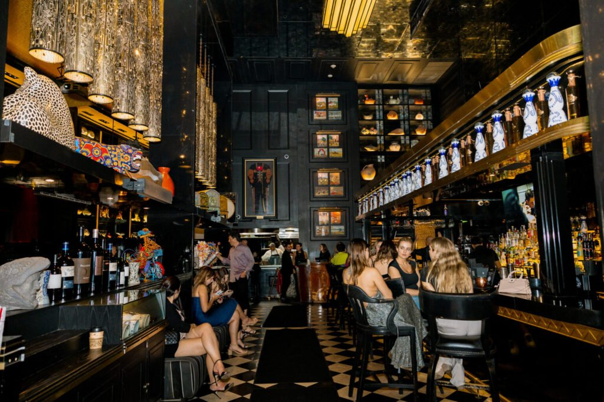

<!-- SINGLE IMAGE -->

In the heart of Brickell, where skyscrapers rise like guardians of modernity and luxury permeates every corner, there exists a culinary refuge that has managed to capture the essence of Mexico with incomparable elegance. Cantina La Veinte is not simply a restaurant, it is a sensory experience that transports its diners through the most authentic and sophisticated flavors of Mexican gastronomy, all while rubbing shoulders with some of the most recognized personalities in international entertainment.

From the moment you cross its doors, the atmosphere envelops you with a warmth that contrasts with Miami's urban bustle. The interiors have been meticulously designed to reflect the cultural richness of Mexico, combining traditional elements with contemporary touches that create an intimate yet vibrant ambiance. The dim lighting, artisanal wood finishes, and carefully selected decorative details invite you to stay, to enjoy, to live each moment as if time stood still.

<!-- SINGLE IMAGE -->

The menu at Cantina La Veinte is a testament to the profound respect for Mexican culinary traditions, elevated through modern techniques and presentations worthy of the world's finest tables. Each dish tells a story, from fresh ceviches that explode on the palate with citrus and spicy notes, to gourmet tacos prepared with the highest quality ingredients that transform a street classic into a gastronomic masterpiece. The chefs, true artists in the kitchen, have achieved that perfect balance between authenticity and innovation that distinguishes great restaurants.

<!-- SINGLE IMAGE -->

It is no coincidence that international celebrities have made this place one of their favorite destinations when visiting Miami. Actors, musicians, athletes, and globally recognized business leaders have been spotted enjoying the privacy and discreet luxury that Cantina La Veinte offers. The staff's discretion and the exclusive atmosphere allow these public figures to relax and enjoy an evening without the constant pressures of fame, knowing they are in a space that values both excellence and intimacy.

Among the most emblematic dishes is the grilled octopus, tender and perfectly seasoned, served on a bed of black bean purée and accompanied by a morita chile sauce that adds depth without overpowering the natural flavors of the sea. The aguachiles, prepared to order with fresh shrimp marinated in citrus juices and green chiles, are an explosion of freshness that awakens all the senses. And for those seeking something more substantial, the chile pasilla crusted ribeye and the slow cooked cochinita pibil are options that have won over even the most demanding palates.

<!-- GALLERY: images are separated by | and cols can be 2, 3 or 4 -->


The experience at Cantina La Veinte would not be complete without exploring its exceptional beverage menu. The restaurant's mixologists have created a selection of artisanal cocktails that pay homage to the finest Mexican spirits, with premium mezcals and tequilas combined with fresh ingredients and innovative techniques. Each drink is a celebration in itself, designed to perfectly complement the intense and complex flavors of the food, creating harmonies that elevate the entire gastronomic experience.

Service at this establishment is another of its fundamental pillars. The team has been trained not only in the technical aspects of luxury hospitality, but also in the art of anticipating the needs of each diner. From personalized recommendations based on individual preferences to attention to the smallest details, each staff member contributes to creating that feeling of being treated like a special guest in an old friend's home, but with all the sophistication of a world class restaurant.

Evenings at Cantina La Veinte have a particular energy, especially during weekends when the restaurant transforms into a social gathering point for Miami's elite. The carefully selected music, ranging from classic boleros to contemporary Latin rhythms, creates the perfect atmosphere for intimate conversations or lively celebrations. It is common to see groups celebrating special occasions, couples on romantic dinners, and international visitors who have heard about the place's reputation and decided to experience it for themselves.

<!-- SINGLE IMAGE -->

Cantina La Veinte is located at 1200 Brickell Avenue, Miami, FL 33131, in the heart of Brickell's financial district. For reservations, you can call (305) 809 3211, and we recommend making your reservation in advance, especially for weekends. You can follow all their news and special events on their Instagram account @cantinlaveinte, where they regularly share their culinary creations and exclusive promotions. The restaurant opens its doors Tuesday through Thursday from 5:00 PM to 11:00 PM, Friday and Saturday from 5:00 PM to 12:00 AM, and Sunday from 5:00 PM to 10:00 PM. For more information about the complete menu and special events, visit their website at [www.cantinlaveinte.com](http://www.cantinlaveinte.com), where you will also find the option to make online reservations and learn more about the culinary philosophy that has made this restaurant one of Miami's most coveted gastronomic destinations.

<!-- SINGLE IMAGE -->

