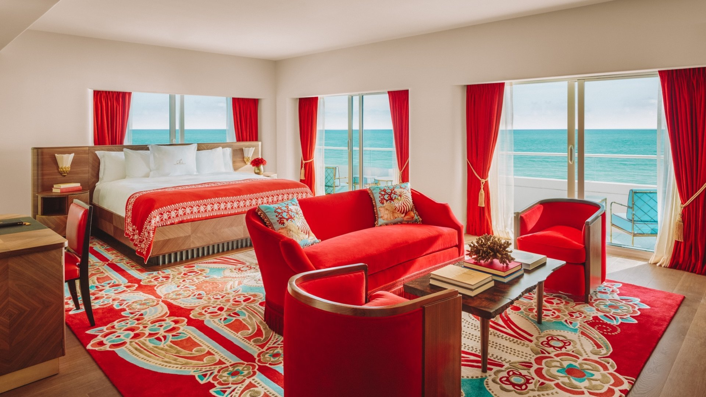
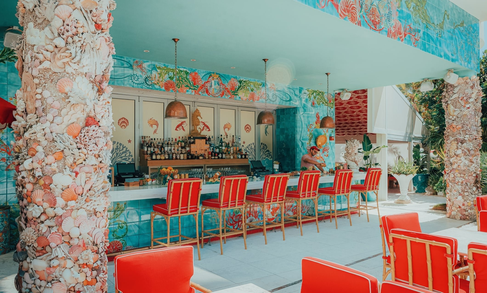
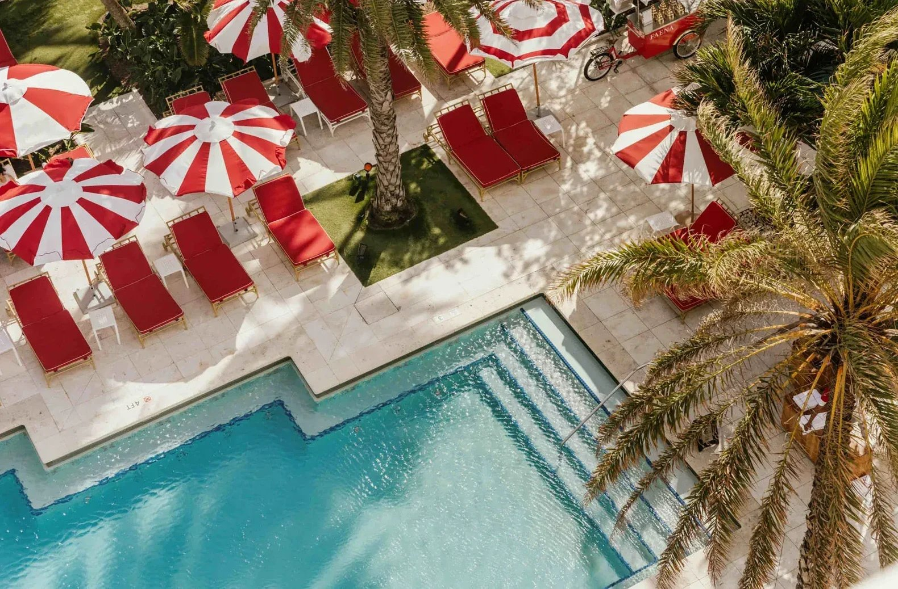
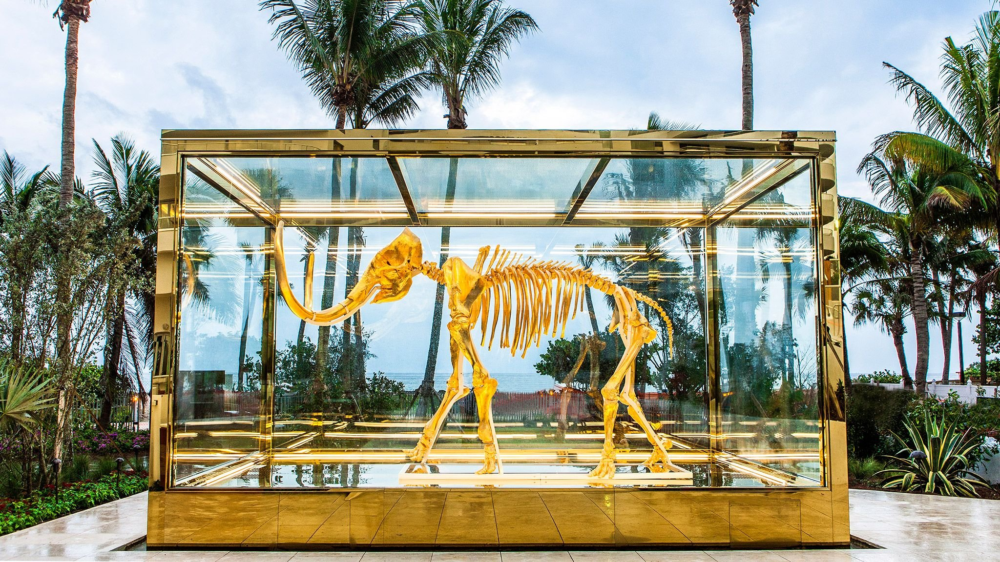
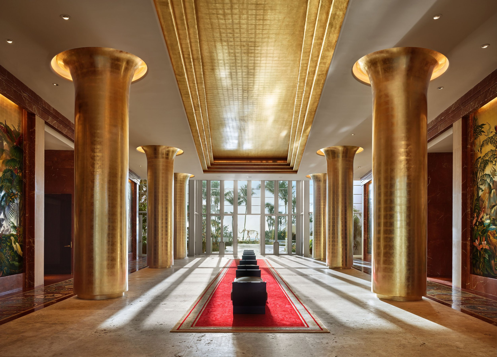

Faena Miami Beach stands as an architectural masterpiece on the shores of South Florida, redefining luxury hospitality in one of the world's most vibrant coastal destinations. This extraordinary oceanfront resort seamlessly blends art, culture, and sophistication to create an immersive experience that transcends traditional hotel stays. Designed by renowned architects and visionaries, the property features stunning Art Deco influences combined with contemporary elegance, making it a landmark destination for discerning travelers seeking something truly exceptional. The accommodations are nothing short of spectacular, offering guests a sanctuary of refined comfort and style with custom furnishings, luxurious materials, and thoughtful details that reflect the property's commitment to excellence.

<!-- SINGLE IMAGE -->

The culinary program at Faena Miami Beach represents a journey through diverse flavors and innovative gastronomy, with multiple dining venues offering distinct culinary perspectives crafted by world-class chefs. From contemporary Argentine cuisine that pays homage to the property's cultural roots to fresh seafood prepared with local ingredients, every restaurant delivers an unforgettable dining experience. Art and culture form the very essence of the Faena experience, with the property serving as a living gallery that celebrates creativity in all its forms through an impressive collection of contemporary artworks, installations, and performances that engage guests throughout their stay.

<!-- SINGLE IMAGE -->

The spa and wellness facilities offer a transformative journey toward relaxation and rejuvenation, drawing inspiration from ancient healing traditions while incorporating modern wellness techniques to deliver personalized treatments. Guests can indulge in signature therapies, therapeutic massages, and innovative beauty treatments administered by skilled practitioners. The wellness amenities include state of the art fitness facilities, yoga and meditation spaces, and hydrotherapy experiences that complement the comprehensive wellness programming designed to promote holistic well-being.

<!-- SINGLE IMAGE -->

The beachfront at Faena Miami Beach provides an idyllic setting for relaxation and recreation, featuring pristine white sand and crystal clear waters. The beach club offers impeccable service with comfortable loungers, private cabanas, and attentive staff ensuring every need is met. Guests can enjoy refreshing cocktails and light cuisine delivered directly to their beachside retreat, creating a seamless experience of luxury and leisure while also having opportunities for water sports and activities that allow them to engage with the natural beauty of Miami Beach.

<!-- SINGLE IMAGE -->

The location offers the perfect balance of tranquil retreat and urban accessibility, situated in the exclusive Mid Beach neighborhood with easy access to the vibrant cultural scene, world class shopping, and entertainment options that make Miami Beach such a desirable destination. Guests can explore nearby art galleries, museums, and design districts, or venture into the heart of South Beach for nightlife and dining adventures while returning to a peaceful oasis removed from the bustle of the most tourist heavy areas.

The service philosophy centers on anticipating and exceeding guest expectations through personalized attention and genuine hospitality. The dedicated staff members are trained to provide discreet, intuitive service that enhances the guest experience without being intrusive. From the moment of arrival through departure, every interaction is designed to create a sense of being welcomed into an exclusive community where individual preferences are remembered and honored.

<!-- SINGLE IMAGE -->

Faena Miami Beach is located at 3201 Collins Avenue, Miami Beach, Florida 33140. Guests can visit the official website at faena.com to explore the full range of accommodations, dining options, and experiences available at this remarkable property. For reservations and inquiries, the hotel can be reached by phone at +1 (305) 534 8800 or by email at reservations@faena.com. Follow Faena on Instagram @faena to discover the latest happenings, special events, and stunning visual glimpses of this extraordinary oceanfront destination where art, culture, and luxury converge to create unforgettable experiences.

<!-- SINGLE IMAGE -->

