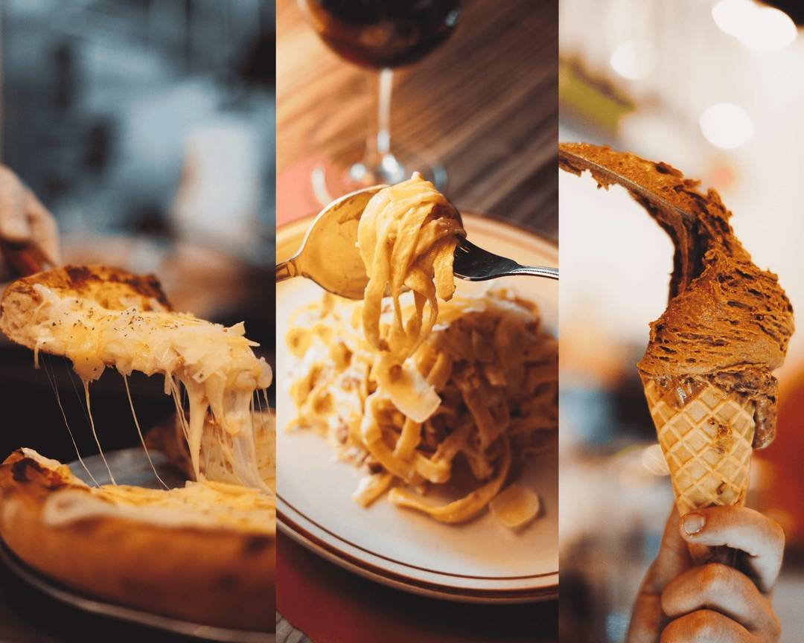
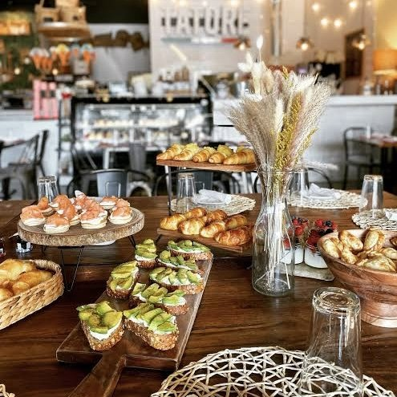
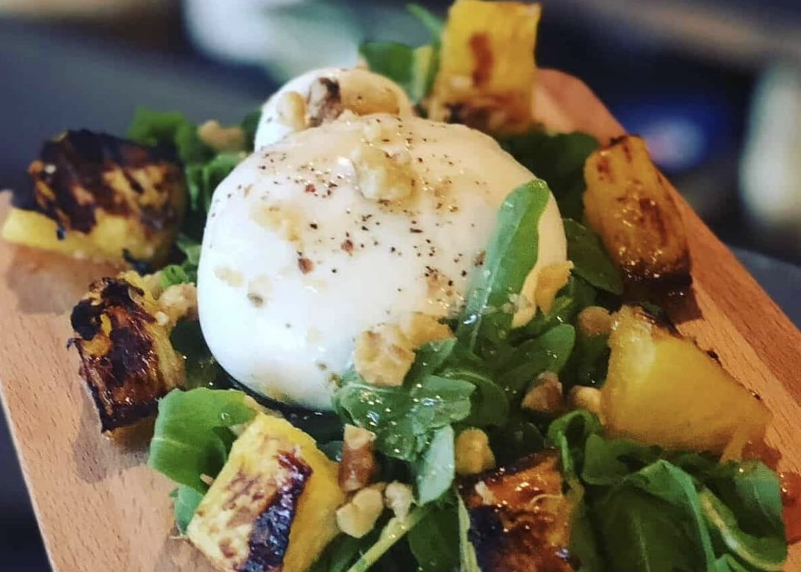

Nestled in the vibrant heart of North Miami Beach, TATORE Ristorante Italiano brings the authentic flavors of Italy to South Florida with a warm, familial touch that makes every guest feel at home. This charming establishment is more than just a restaurant; it represents the continuation of a proud culinary legacy that spans three generations and crosses continents, from the cobblestone streets of Italy to the bustling avenues of Argentina, and now to the sun drenched shores of Miami.

The story of TATORE begins in 1947 when Salvatore "Tatore" Guarracino made the courageous decision to leave his beloved Italy and venture to Argentina, where he would make his mark in the world of gastronomy. What started as a leap of faith transformed into an extraordinary success story, as Tatore established 【entity-Freddo¦canonical_name=Freddo】, one of Argentina's most iconic ice cream companies. His dedication to quality, authenticity, and the art of Italian food preparation became the foundation upon which the family's culinary reputation was built, creating a legacy that would inspire future generations.

<!-- SINGLE IMAGE -->

Today, the torch has been passed to the third generation of the Guarracino family, who have chosen Miami as the home for their latest venture. TATORE Ristorante Italiano embodies the same principles that made their grandfather successful: an unwavering commitment to fresh, homemade food prepared with love and respect for traditional Italian recipes. The restaurant serves as a bridge between the old world charm of Italian cuisine and the contemporary, diverse culinary landscape of Miami, offering diners an experience that is both nostalgically familiar and excitingly fresh.

At the heart of TATORE's culinary operation is their brick oven, which serves as the centerpiece of the restaurant and the source of many of their signature dishes. This traditional cooking method imparts a distinctive flavor and texture to their pizzas and other baked creations, reminiscent of the authentic trattorias found throughout Italy. The brick oven represents more than just a cooking tool; it symbolizes the restaurant's dedication to preserving time honored cooking techniques while creating a gathering place where young people, families, and friends can come together to share memorable meals.

<!-- SINGLE IMAGE -->

The recipes used at TATORE are not merely collected from cookbooks or culinary schools; they are treasured family heirlooms passed down directly from the founders' grandparents. Each dish tells a story of tradition, love, and the careful refinement that comes from generations of practice and passion.

From handcrafted pastas to perfectly balanced sauces, every element on the menu reflects the authentic Italian cooking methods that have been preserved and perfected within the Guarracino family over decades.

<!-- SINGLE IMAGE -->

TATORE's commitment to quality extends to every ingredient that enters their kitchen, with an emphasis on fresh, handcrafted preparations that honor the Italian culinary tradition of letting superior ingredients speak for themselves. The menu showcases a variety of classic Italian dishes, each prepared with meticulous attention to detail and a respect for the authentic flavors that define Italian cuisine. From appetizers to desserts, diners can expect food that is made from scratch daily, ensuring that every meal delivers the freshness and quality that the Guarracino name has represented for generations.

The restaurant's gallery and visual presentation demonstrate the artistry that goes into each dish, with beautiful photographs showcasing everything from roasted vegetables to fresh salads and decadent pastries. These images reflect the care and creativity that the kitchen staff brings to every plate, transforming simple ingredients into visual and culinary masterpieces. The attention to presentation mirrors the Italian belief that food should appeal to all the senses, creating an experience that delights the eyes before the first bite is even taken.

<!-- SINGLE IMAGE -->

What truly sets TATORE apart in Miami's competitive dining scene is the genuine passion and family heritage that infuses every aspect of the restaurant. This is not a corporate establishment following a formula; it is a family's dream realized, a continuation of a story that began nearly eight decades ago in Italy. The third generation of Guarracinos has taken the lessons learned from their grandfather's success and adapted them to create a restaurant that honors the past while embracing the future, offering Miami diners an authentic taste of Italian hospitality and cuisine.

For those wishing to experience TATORE Ristorante Italiano, the restaurant is conveniently located at 14730 Biscayne Boulevard, North Miami Beach, FL 33181, United States. Guests can make reservations or inquire about the menu by calling (305) 749 6840. Online ordering is also available for those who wish to enjoy TATORE's homemade Italian cuisine in the comfort of their own homes. The restaurant welcomes diners to explore their offerings, connect with their culinary heritage, and become part of the TATORE family story that continues to unfold in Miami.

<!-- SINGLE IMAGE -->

[https://tatoremiami.com/](https://tatoremiami.com/)
