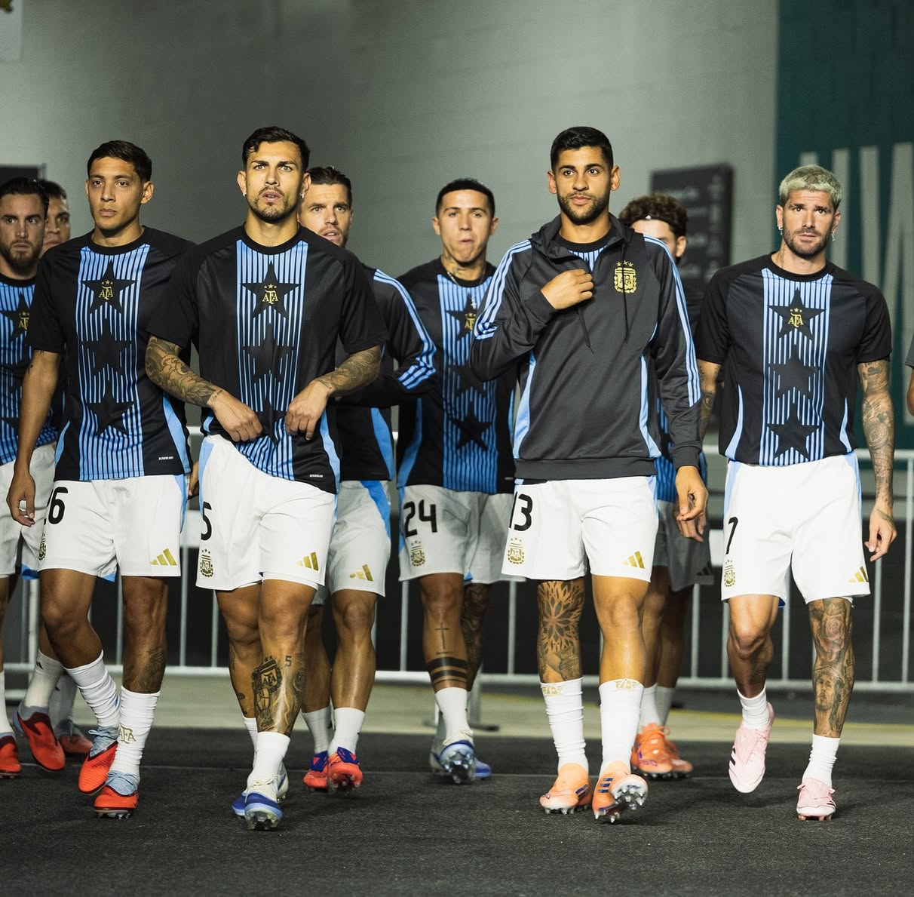

Miami welcomed the Argentina National Team as if a movie star were arriving on the red carpet. Two friendlies against Venezuela and Puerto Rico became more than just preparation matches: they were confirmation that this world champion team understands that their image is as important as their results. With each arrival at the stadium, at each press conference, the players displayed a sophisticated visual code that speaks of both present and future.

The first match, played on October 10 at Hard Rock Stadium, pitted Argentina against Venezuela. Without Lionel 【entity-Messi¦canonical_name=Messi】 on the field, the team led by 【entity-Lionel Scaloni¦canonical_name=Lionel Scaloni】 showed a tactical and austere but effective face. A goal by 【entity-Giovani Lo Celso¦canonical_name=Giovani Lo Celso】 was enough to secure a 1-0 victory. Meanwhile, the stands looked like a sports fashion gallery: personalized jerseys, vintage caps, and accessories that elevated the classic sky blue and white to global trend status.

<!-- GALLERY: images are separated by | and cols can be 2, 3 or 4 -->


Four days later, at Chase Stadium in Fort Lauderdale, Argentina crushed Puerto Rico 6-0 with 【entity-Messi¦canonical_name=Messi】 back and in his best playmaker form. Two assists from the captain sealed a perfect afternoon, but what happened off the pitch was equally striking. The players arrived at the stadium with carefully assembled looks: oversize jackets, limited edition sneakers, minimalist sunglasses. They didn't look like footballers going to a match, but influencers attending an exclusive event.

<!-- GALLERY: images are separated by | and cols can be 2, 3 or 4 -->


The home jersey, redesigned by 【entity-Adidas¦canonical_name=Adidas】 with metallic details and golden touches in honor of the third world star, became the visual symbol of this tour. More than sports apparel, it's a statement of principles: Argentina didn't just win the World Cup, they did it with style and want that to be clear at every appearance. Every photo posted on social media reinforced the message: we are champions and we know how to dress like it.

<!-- GALLERY: images are separated by | and cols can be 2, 3 or 4 -->


From a football perspective, Scaloni took advantage of both matches to rotate players, test tactical variations, and maintain the cohesion of a group that no longer depends solely on Messi to function. The victory against Venezuela without their captain was a test of maturity; the rout against Puerto Rico, a reminder that with him on the field, anything is possible. But beyond the goals, what became evident is that Argentina has a solid project both on and off the field.

Miami, a city where luxury, multiculturalism, and global trends converge, proved to be the perfect setting for this exhibition. The players strolled through Brickell, posed in five-star hotel lobbies, and shared moments on social media that seemed straight out of an advertising campaign. The Argentina National Team is no longer just a football team: it's a brand, a lifestyle, a recognizable aesthetic in any corner of the planet.

<!-- GALLERY: images are separated by | and cols can be 2, 3 or 4 -->


The phenomenon is not accidental. In a world where sport and fashion feed off each other, Argentina understood that communicating well is part of winning. Every detail counts: from the players' haircuts to the type of watch they wear when getting off the plane. Image is cared for with the same dedication as physical preparation, and it shows. It's not vanity, it's professionalism adapted to current times.

<!-- SINGLE IMAGE -->

In the end, the Miami tour left more than two victories on the scoreboard. It left a clear picture: Argentina is world champion and behaves as such in every aspect. Because in 2025, being great in football also means knowing how to present yourself to the world. And in that, the Albiceleste no longer has rivals.
