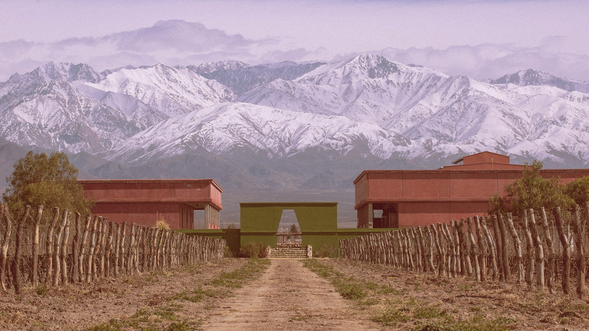

<!-- SINGLE IMAGE -->

We were invited to live a unique experience with one of the most recognized Argentine wine brands in the world: CATENA Zapata. Not only did we taste the best wines, but we also learned a lot about how they are produced and enjoyed an exceptional gastronomy. The history of this winery began in 1902, when Nicola Catena, an Italian immigrant, arrived in Argentina and planted his first vineyards in Mendoza. Throughout four generations, the Catena family has dedicated its life to viticulture, turning the winery into a world reference for high quality wines that today combines tradition, innovation and an unparalleled gastronomic proposal.

The person in charge of making this experience unforgettable was Martín, the winery's chef, who with his culinary secrets has become a true master of Mendoza's gastronomy. Martín is responsible for all of Ernesto Catena's gastronomic projects and is also associated with Johana Foster in a project to elaborate mainly with aged crianza grapes. His mission is clear: that every visitor comes and fully enjoys the experience, immersing themselves in Mendoza's culture through every dish and every glass of wine.

Both in Tikal and in other CATENA Zapata properties, a unique and surprise menu is offered. There is no menu to choose from, but when making a reservation, visitors are consulted about dietary restrictions or preferences, allowing the experience to be personalized for each group. This gastronomic proposal is based on Mendoza's tradition: in Tikal, for example, the menu is inspired by the barbecue style with clay oven, while in other places "the winemaker's cuisine" is offered. Martín always seeks to leave Mendoza's culture and tradition present in every dish he prepares, honoring the roots of this wine-producing land.

According to Martín, what cannot be missing on the table when enjoying these wines is good produce. The Mendoza tomato, considered one of the best in the world, is a star ingredient. A simple tomato dish with olive oil and a touch of balsamic vinegar can be enough to accompany a great wine. The empanadas baked in the clay oven are another essential classic that is never missing in the experience. Martín's philosophy is clear: to pair one good product with another so that they mutually enhance each other, taking advantage of the great variety of vegetables and fruits grown in Mendoza along with the winery's exceptional wines.

<!-- GALLERY: images are separated by | and cols can be 2, 3 or 4 -->


When asked about his favorite wines, he shared his top three: Tikal Júbilo, a Malbec Cabernet Sauvignon that he likes very much; Johana's Campo del Cielo, which he considers very rich; and Cosmovisión, an orange wine. However, he admitted that it is difficult to choose just three, as both Ernesto and Johana have many labels, which ensures that there is always something new to discover and you never get bored. This diversity of options is part of the legacy that Nicolás Catena Zapata, the third generation of the family, began to build in the 1980s.

Nicolás Catena Zapata revolutionized the Argentine wine industry by introducing innovative techniques inspired by his studies in California. He pioneered planting vineyards at high altitude in the Andes, discovering that these extreme conditions produced grapes of exceptional quality, especially the Argentine Malbec that is now recognized worldwide. This transformative vision not only elevated the quality of Argentine wines, but also created the basis for an equally exceptional dining experience at the winery, uniting terroir, tradition and excellence in every glass.

<!-- SINGLE IMAGE -->

In 1992, the winery launched its first flagship wine, Catena Zapata, a blend of Malbec and Cabernet Sauvignon that quickly gained international recognition. Since then, CATENA Zapata has won numerous awards and has been instrumental in putting Argentine wines on the world fine wine map. This commitment to excellence is reflected not only in their wines, but also in every detail of the experience they offer to their visitors, where gastronomy plays a leading role.

The experience culminated with a special dessert that Ernesto Catena calls "tortuga" (turtle). This dessert consists of cream with goat cheese, dulce de leche, peanut paste, toasted hazelnuts and a peach in homemade syrup on top. The name comes from its shape, which resembles a small turtle, and its taste left everyone with a smile. It is the perfect finishing touch to a day that combines history, tradition, innovation and authentic flavors of Mendoza.

<!-- GALLERY: images are separated by | and cols can be 2, 3 or 4 -->


Today, under the leadership of the fourth generation with Laura Catena and her siblings, the winery continues its legacy of innovation and excellence, always maintaining respect for the family tradition and the Mendoza terroir that makes its wines unique. This generational continuity ensures that every visit to CATENA Zapata is not only a tasting, but a complete immersion in more than a century of Argentine wine history.

**More information:**

Website: [www.catenawines.com](https://www.catenawines.com)

Instagram: [@catenawines](https://www.instagram.com/catenawines)

<!-- SINGLE IMAGE -->

