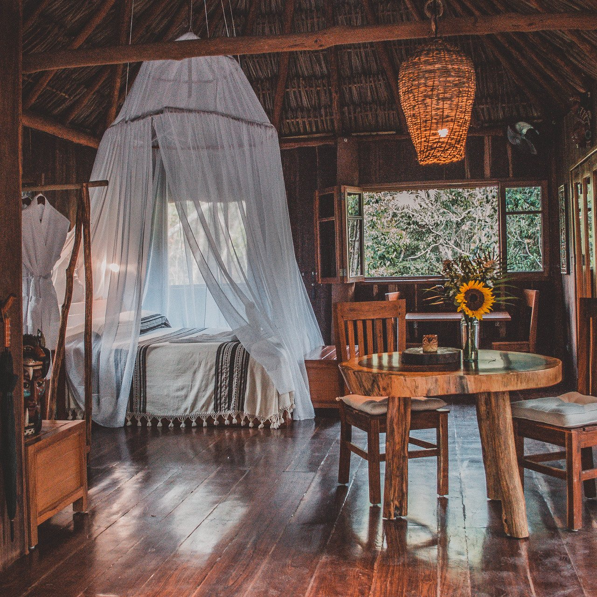

Ajal Tulum Tree Houses is an adults‑only, eco‑boutique hotel in Tulum, Mexico, offering an authentic connection with nature without sacrificing luxury and comfort.

<!-- VIDEO: YouTube or Vimeo link, or file="/assets/video/clip.mp4" -->


We had the privilege of visiting this paradise and speaking with Carlos, who welcomed us and shared the vision behind this exceptional project. “This is an oasis in the jungle,” were our first words as we took in the majesty of the place, and we couldn’t have described this transformative experience better.

Ajal Tulum goes beyond the traditional hotel concept. It features four boutique tree houses raised 10 to 16 feet above the forest floor, suspended within the canopy. The complex includes a bar and restaurant with a demo kitchen and a 50‑foot jungle observation tower. It sits just steps from Cenote Escondido and Cenote Cristal, famed for their crystal‑clear waters and underwater cave systems.

<!-- SINGLE IMAGE -->

Ajal’s philosophy stems from a deep commitment to the environment and a desire to recover the essence of authentic Tulum.

As Carlos explained, “as people who care about the environment, we wanted to create a space that protects the planet while offering an incomparable luxury experience.” The project strikes a perfect balance between sustainability and comfort.

Each of the four tree houses — Tzalam, Zapote, Chaká, and Chechén — is designed for complete privacy, set more than 50 feet apart. Ranging from roughly 430 to 650 square feet, they include generous private balconies with hammocks and café tables for two, king or queen canopy beds, en‑suite bathrooms with bidet, and open‑air showers overlooking the jungle. Vaulted palapa roofs, polished wood floors, and screened windows complete the rustic‑luxury feel.

The observation tower is pure magic. From its terrace, about 50 feet above ground, you’re embraced by a sea of treetops. Spot toucans, howler monkeys, coatis, and an impressive variety of birds while the jungle breeze brushes your skin. It’s perfect for meditation, sunrise yoga, or simply contemplating the surrounding natural spectacle.

<!-- SINGLE IMAGE -->

Ajal is a standout example of sustainable tourism. The property runs completely off‑grid, using solar panels mounted atop the observation tower to generate clean energy.

Water comes from nearby Mayan underground rivers, naturally filtered and abundant. Each structure uses eco‑friendly underground biodigesters, and the project incorporates a comprehensive composting system. Building materials are locally sourced, including wood, stone, and innovative “coco‑crete.”

The strategic location lets you explore the best of the Riviera Maya. Just 3 miles from Tulum’s center, you have easy access to iconic Caribbean white‑sand beaches, ancient Mayan ruins, Kaan Luum Lagoon, the Sian Ka’an Biosphere Reserve (a UNESCO World Heritage Site), and world‑class dining. Cenotes Escondido and Cristal, renowned for cave diving, are only a quarter‑mile away.

Ajal Tulum Tree Houses is more than a place to stay; it’s an invitation to reconnect with nature, with yourself, and with the essence of the real Tulum. As we said goodbye to Carlos, we reflected on the importance of supporting projects that prove luxury and sustainability can coexist in harmony. Experience this unique retreat and discover your own oasis in the Mayan jungle.

<!-- GALLERY: images are separated by | and cols can be 2, 3 or 4 -->


For more information and to plan your stay:

**Website:** [www.ajaltulum.com](http://www.ajaltulum.com)

**Instagram:** @ajaltulumtreehouses
