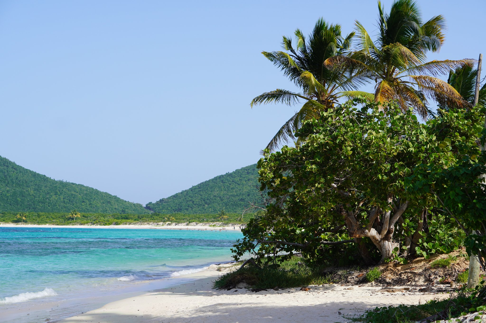

<!-- SINGLE IMAGE -->

Just a 30 minutes flight from San Juan, the island of Culebra unfolds like a small Caribbean paradise. Getting here is an experience in itself: hop on a light aircraft with [Air Flamenco](https://www.airflamenco.net/) ([@airflamencopr](https://www.instagram.com/airflamencopr)), which runs daily flights from Isla Grande Airport. You’ll enjoy jaw‑dropping aerial views of turquoise waters and white‑sand beaches before landing in this natural refuge. In under half an hour, you go from urban bustle to total island relaxation.

<!-- SINGLE IMAGE -->

Flamenco Airplane

Puerto Rico is only about a two‑hour flight from Miami or many other points in the Caribbean, making Culebra perfect for quick getaways. While a day trip is ideal for beaches and activities, staying one or two nights lets you discover its quieter, more unhurried side.

<!-- SINGLE IMAGE -->

If you’re looking for lodging, the island has options for every style. [Club Seabourne](https://www.clubseabourne.com/) ([@clubseabourne](https://www.instagram.com/clubseabourne)) blends low‑key luxury with nature, offering villas overlooking Fulladoza Bay, a pool, Azul restaurant with à la carte breakfast, a private dock, and water sports. This intimate boutique hotel is perfect for a chic, exclusive Caribbean escape.

For those who want more privacy and space, [Culebra Island Villas](https://www.culebraislandvillas.com/) ([@culebraislandvillas](https://www.instagram.com/culebraislandvillas)) offers fully equipped private villas, ideal for families or groups seeking a home‑like refuge. And for something more laid‑back and close to local life, [Mamacita’s Guest House](https://www.mamacitasgh.com/) ([@mamacitasguesthouse](https://www.instagram.com/mamacitasguesthouse)) welcomes you with an authentic experience, personalized attention, and a charming Caribbean style that makes you feel at home.

Life in Culebra is best enjoyed in daylight, but staying a few nights lets you catch violet sunsets over the sea, soak in absolute quiet, and savor the island vibe without rushing. Every moment becomes memorable: ocean‑view breakfasts, kayaking across glassy bays, and starry nights that feel infinite.

<!-- SINGLE IMAGE -->

Locals welcome you with a smile and invite you to discover secret corners: small restaurants serving fresh‑caught seafood, hidden cafés with the best Puerto Rican coffee, and trails leading to secluded coves where you might be the only visitor. Genuine, warm hospitality is core to the experience.

Culebra combines adventure, relaxation, and raw nature, perfect for disconnecting while staying in the heart of the Caribbean. Whether you come for a day or a few, every corner invites you to slow down, breathe deep, and reconnect with what matters.

If you want a place you don’t just visit but truly feel, Culebra is it. From the adrenaline of a small‑plane flight to the peace of Flamenco Beach, from the understated luxury of Club Seabourne to the authenticity of Mamacita’s, this island promises an unforgettable journey for anyone dreaming of a slice of paradise.

<!-- GALLERY: images are separated by | and cols can be 2, 3 or 4 -->
{% include gallery.html folder="/images/travel" images="Puerto_Rico_20190302_2099.jpg|Puerto_Rico_20190302_2200.jpg|Puerto_Rico_20190302_2185.jpg|Puerto_Rico_20190302_2073.jpg|Puerto_Rico_20190302_2065.jpg|Puerto_Rico_20190302_2039.jpg|Puerto_Rico_20190302_2051.jpg|Puerto_Rico_20190302_2018.jpg|Puerto_Rico_20190302_2034.jpg|Puerto_Rico_20190301_1930.jpg|Puerto_Rico_20190302_1962.jpg|Puerto_Rico_20190301_1917.jpg|Puerto_Rico_20190301_1923.jpg|Puerto_Rico_20190301_1889.jpg|Puerto_Rico_20190301_1894.jpg|Puerto_Rico_20190301_1840.jpg|Puerto_Rico_20190301_1853.jpg|Puerto_Rico_20190301_1809.jpg|Puerto_Rico_20190301_1802.jpg|Puerto_Rico_20190301_1788.jpg|Puerto_Rico_20190301_1790.jpg|Puerto_Rico_20190301_1787.jpg|Puerto_Rico_20190301_1769.jpg|Puerto_Rico_20190301_1668.jpg|Puerto_Rico_20190301_1659.jpg|Puerto_Rico_20190301_1624.jpg|Puerto_Rico_20190301_1609.jpg|Puerto_Rico_20190301_1544.jpg|Puerto_Rico_20190301_1529.jpg|Puerto_Rico_20190301_1446.jpg" cols=3 %}
