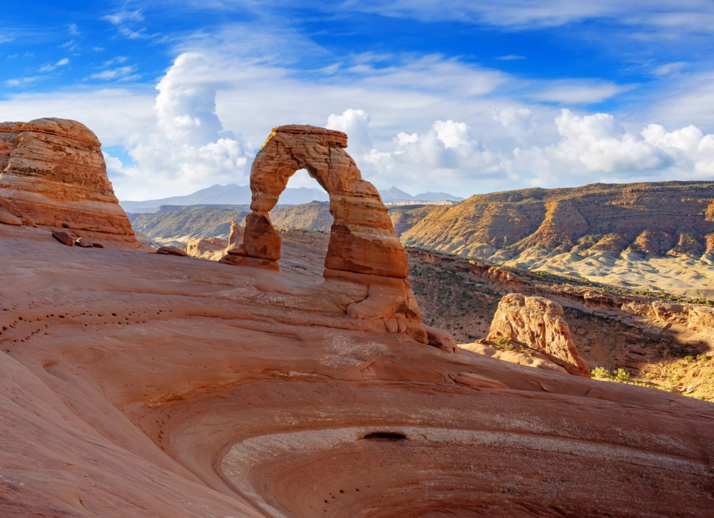

Moab is far more than a tourist destination; it is a full‑sensory experience that blends the majesty of desert landscapes with extreme adventure. Located in the heart of eastern Utah, this city of just over 5,000 residents has become the epicenter of adventure tourism in the United States, drawing millions each year who want to connect with nature in its purest, most spectacular form.

<!-- VIDEO: YouTube or Vimeo link, or file="/assets/video/clip.mp4" -->


Arches National Park, just minutes from town, is home to more than 2,000 natural sandstone arches, including the famous Delicate Arch, an iconic symbol of Utah. Sculpted by millions of years of erosion, these formations create a surreal landscape that changes color with the light of day, shifting from deep reds at sunrise to bright oranges at sunset. Photographers and nature lovers are treated to an incomparable visual spectacle.

Southwest of Moab lies Canyonlands National Park, a vast expanse of 527 square miles divided into four districts by the confluence of the Colorado and Green rivers. The park offers sweeping views of mesas, deep canyons, and spires of rock that rise toward the sky, forming a natural labyrinth that begs to be explored. Overlooks such as Mesa Arch and Grand View Point offer perspectives that feel otherworldly.

<!-- GALLERY: images are separated by | and cols can be 2, 3 or 4 -->


The Colorado River flows through Moab and is renowned for world‑class rapids that attract rafters and kayakers from around the globe. This legendary river, which carved the Grand Canyon and other natural wonders, provides not only adventure but also a vital resource for more than 40 million people in the American Southwest. Paddling its waters is a journey through the continent’s geologic history wrapped in the excitement of turbulent currents.

For mountain bikers, Moab is a sanctuary. The famous Slickrock Trail, with 12 miles of smooth, grippy sandstone, delivers a unique ride that blends technical challenge with spectacular views. The region’s extensive trail network, with routes for all levels, has cemented Moab as the mountain‑biking capital of North America, hosting international events year‑round.

<!-- SINGLE IMAGE -->

Beyond adrenaline, Moab offers rich cultural experiences. The Moab Museum hosts fascinating collections, including dinosaur fossils discovered in the region, archaeological artifacts from the Indigenous cultures that inhabited these canyons, and exhibits on the uranium‑mining history that shaped the city’s economic development in the 20th century.

Tourism infrastructure in Moab has evolved to meet visitor needs without losing small‑town charm. Restaurants range from gourmet cuisine to American classics. There are specialty outdoor‑gear shops, art galleries that capture the essence of the desert, and accommodations from stargazing campgrounds to boutique hotels, offering options for every taste and budget.

Visiting Moab is a transformative journey where the vastness of the desert landscape puts you in awe of nature’s grandeur. It’s a place to disconnect from the modern world and reconnect with what matters, where each sunrise brings new adventures and each sunset leaves indelible memories. For MIAMIX, Moab represents the perfect balance between experiential luxury and natural authenticity, a destination every sophisticated traveler should have on their list.

<!-- SINGLE IMAGE -->

<!-- GALLERY: images are separated by | and cols can be 2, 3 or 4 -->

