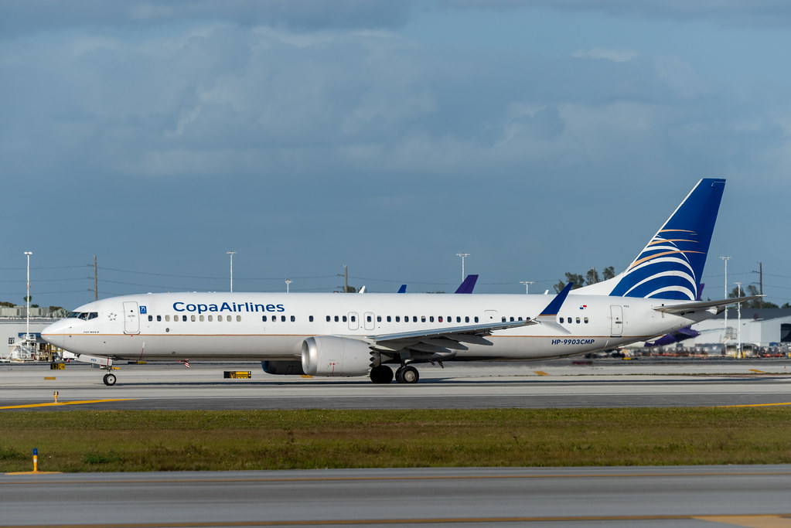

<!-- SINGLE IMAGE -->

【entity-Copa Airlines¦canonical_name=Copa Airlines】 often enters the Miami conversation the way a well timed connection does, quietly and efficiently, until you realize how many journeys across the Americas depend on the rhythm of its network and the geographic advantage of Panama.

For travelers leaving Florida, especially Miami, the story usually begins with a short flight south and a smooth transition through Copa’s hub at Tocumen International Airport in Panama City, where the airline has turned location into strategy and turned strategy into a map that reaches nearly every corner of the hemisphere.

From that hub, routes branch out like a well edited itinerary, linking North America, Central America, South America, and the Caribbean with schedules built for real life travel, the kind that makes same day connections feel natural and makes multi country trips feel simpler than they should.

Miami plays a leading role in that network, because it is one of the gateways where business, family ties, and leisure travel converge, and Copa’s frequent service from Miami helps keep the region connected to Panama and beyond with the consistency that frequent flyers learn to trust.

Across Florida, the airline’s presence extends the same promise of reach, offering options that help travelers move between key cities and the wider Americas through a single hub, which is often the difference between an exhausting travel day and one that feels surprisingly seamless.

On board, the experience shifts from logistics to comfort, and Copa’s business class becomes part of the narrative for anyone who values space, service, and a calmer pace, especially on routes where arriving rested matters as much as arriving on time.

By the time the wheels touch down again in Florida, what stays with you is the feeling that Copa Airlines is not only moving people between airports, it is stitching together the Americas through Panama with a network designed to keep Miami and the region within easy reach of an entire continent.

Website: [https://www.copaair.com/](https://www.copaair.com/)

Instagram: [@copaairlines](https://www.instagram.com/copaairlines/)

<!-- SINGLE IMAGE -->

